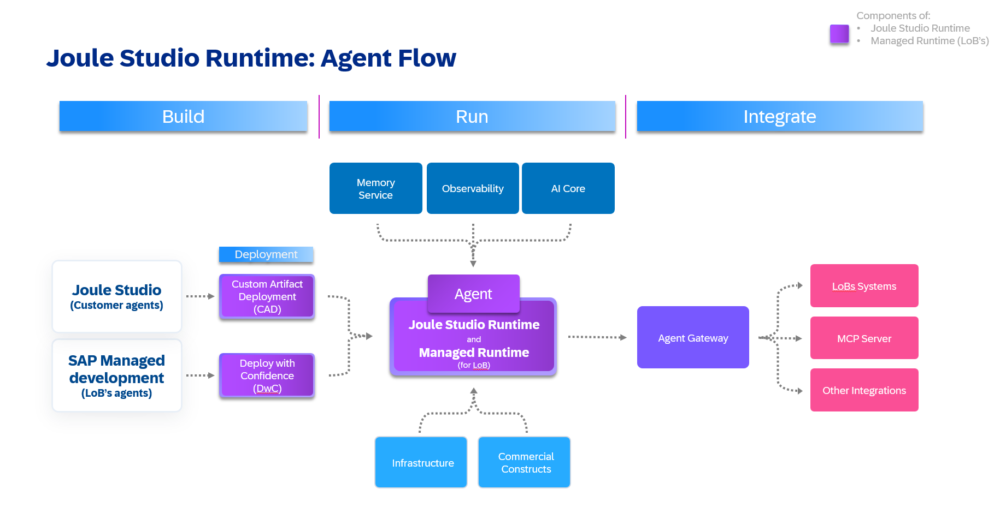
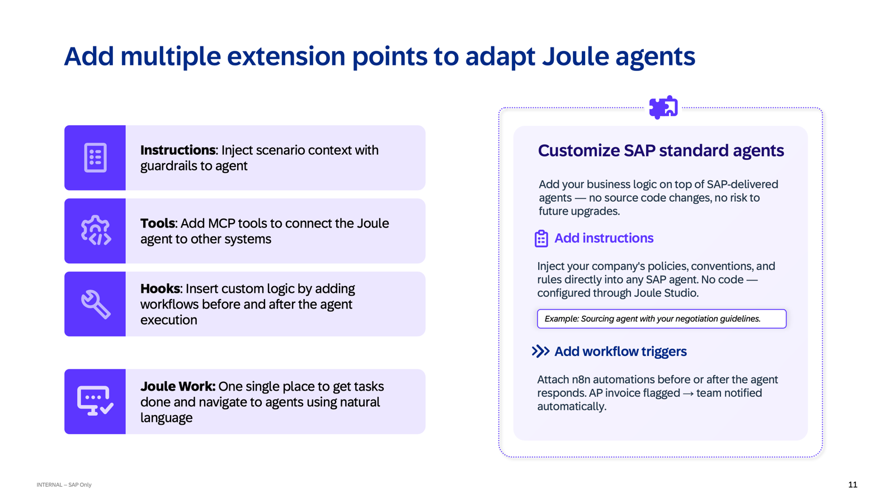
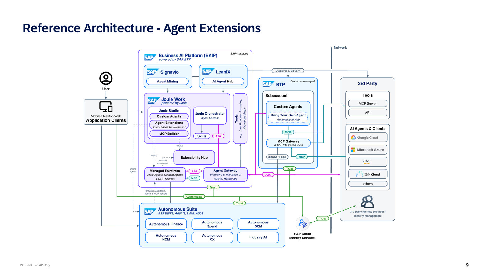
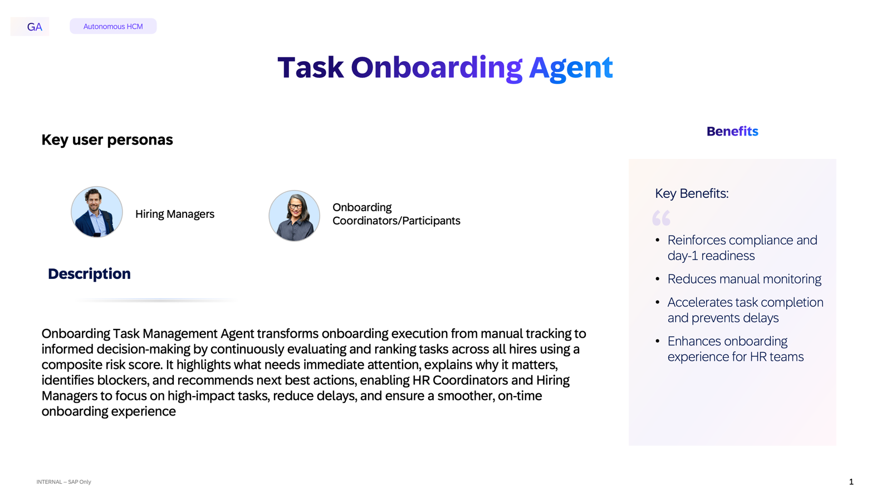
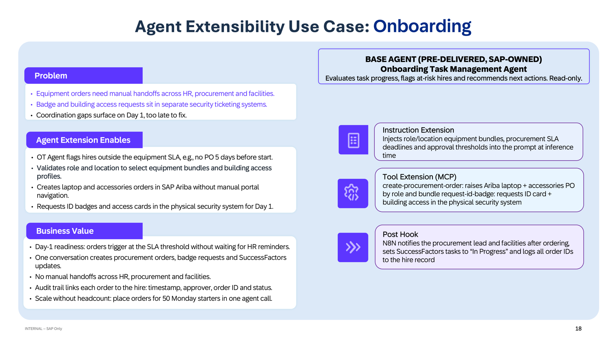

# AD264 — Building Enterprise Agent Extensions with SAP Joule Studio

## Description

This repository contains the exercise guide for the SAP TechEd 2026 session **AD264 — Building Enterprise Agent Extensions with SAP Joule Studio**.

---

## What is Joule Studio?

Joule Studio is how you build trusted, custom agentic solutions — not just prototypes, but agents you can run in the enterprise.

**Intent-Based Development** — You start by describing the outcome you want, and Joule Studio helps translate that intent into working solutions — whether you're building agents, apps, or workflows. It supports the full spectrum from no-code to pro-code, and lets developers bring their own tools rather than forcing a single environment.

**Business Context** — Agents only perform reliably when they're grounded in how your business runs. Joule Studio anchors agents in SAP's context: the SAP Knowledge Graph, the SAP family of models, and the underlying SAP data, processes, and applications they need to reason over and act on correctly.

**Trusted Governance** — This is how you scale with confidence: with an Agent Hub to manage what's deployed, Process Insights to understand behavior and impact, and a Managed Runtime so operations, controls, and oversight are built in — not bolted on later.

Joule Studio takes you from intent, to context-grounded execution, to governed scale — so your agentic solutions are trusted from day one.

---

## What is Joule Studio Runtime?

You build it. We run it.

Joule Studio Runtime provides the operational foundation to build, deploy, observe, and scale enterprise AI applications and agents — delivering trusted guardrails, integration, and extensibility. While you own the AI logic (the intent, the rules, the risk appetite, the business value), SAP owns the runtime: from infrastructure to lifecycle to integration.

### Trusted Guardrails

Agents run in ephemeral, sandboxed containers with no persistent state or cross-tenant access, enforcing strict isolation at execution time. Agent lifecycle management — versioning, start, stop, and rollback — is handled through the runtime, ensuring every agent instance meets the same quality, security, and lifecycle standard. SAP's own agents run on this same managed runtime, discoverable and activatable through the SAP Discovery Center.

### Trusted Integration

Deployment is fully automated through a pipeline into Joule Studio Runtime — no Kubernetes management, no manual infrastructure provisioning required. Out-of-the-box OpenTelemetry instrumentation delivers traces, metrics, and logs from day one, with AI actions consumption surfaced as a transparent cost metric for clear spend visibility. SAP handles provisioning, identity management, scaling, availability, and upgrades — the full operational layer.

### Trusted Extensibility

You can tailor agent behavior to your business context without touching the underlying agent code:

- **Instruction extensions** — adjust language, apply business policies, reorder results, or add clarification steps.
- **Hooks** (powered by n8n) — inject custom logic before or after agent execution: access checks, downstream system updates, approvals, or notifications — including connections to non-SAP systems via APIs and MCPs.

---

## How Extensions Work

Extensions slot directly into the Joule Studio Runtime architecture. Once deployed via Custom Artifact Deployment (CAD), your extension runs alongside the pre-delivered agent — the Agent Gateway handles outbound calls to MCP servers, LoB systems, and other integrations.

### Extension types

### Reference architecture

---

## The Use Case: Onboarding Task Management

All three exercises use the same pre-delivered SAP agent: the **Onboarding Task Management Agent**.

This agent transforms onboarding execution from manual tracking to informed decision-making — continuously evaluating and ranking tasks across all hires using a composite risk score. It highlights what needs immediate attention, identifies blockers, and recommends next best actions for Hiring Managers and Onboarding Coordinators.

Out of the box it already does a lot. In this session you will extend it to do more — enforcing compliance prioritization, raising Ariba procurement requests, and adding pre/post execution hooks — all without touching its source code.

### The extensibility opportunity

---

## Session Overview

Pre-delivered SAP agents are powerful out of the box. But the moment you sit down with a real HR team or a real onboarding process, you quickly discover the gaps. In this session, you'll close those gaps yourself — using Joule Studio's Intent-Based Development to describe the behaviour you need in plain language and watch it become a working extension. No boilerplate, no manual configuration, no specialist development skills required.

By the end of the session, you'll have built agent extensions across multiple extension types and have a pattern you can take home and apply to any pre-delivered SAP agent in your landscape.

---

## Learning Objectives

By the end of this session you will be able to:

- Describe the Joule Studio architecture and how the runtime provides trusted, managed execution for enterprise agents
- Explain the three extension types — instruction extensions, MCP extensions, and hooks — and when to use each
- Use Intent-Based Development to create agent extensions in plain language without writing boilerplate code
- Deploy extensions via Custom Artifact Deployment (CAD) into the Joule Studio Runtime
- Apply the extension pattern to any pre-delivered SAP agent in your own landscape

---

## Requirements

All system access required for this session will be provided to you. During the hands-on exercises you will be working with:

- **SAP Joule Works** with the pre-delivered Onboarding Task Management Agent
- **SAP Joule Studio** (Intent-Based Development)
- **SAP Ariba** integration via MCP (Exercise 2)

Credentials and tenant URL will be provided at your desk.

---

## Exercises

- [Exercise 1 — Extend the Onboarding Task Manager Agent: Instruction Extension - Compliance Task Prioritization](exercises/ex1/)
- [Exercise 2 — Extend the Onboarding Task Manager Agent: MCP Extension – SAP Ariba Equipment Ordering](exercises/ex2/)
- [Exercise 3 ★ Bonus — Extend the Onboarding Task Manager Agent: Pre-Hook & Post-Hook](exercises/ex3/)

---

## Contributing

Please read the [CONTRIBUTING.md](CONTRIBUTING.md) to understand the contribution guidelines.

## Code of Conduct

Please read the [SAP Open Source Code of Conduct](https://github.com/SAP/.github/blob/main/CODE_OF_CONDUCT.md).

## How to Obtain Support

Support for the content in this repository is available during the actual time of the online session for which this content has been designed. Otherwise, you may request support via the [Issues](../../issues) tab.

## License

Copyright (2026) SAP SE or an SAP affiliate company and contributors. Please see our [LICENSE](LICENSE) for copyright and license information. Detailed information including third-party components and their licensing/copyright information is available via the [REUSE tool](https://api.reuse.software/info/github.com/SAP-samples/teched2026-AD264).
