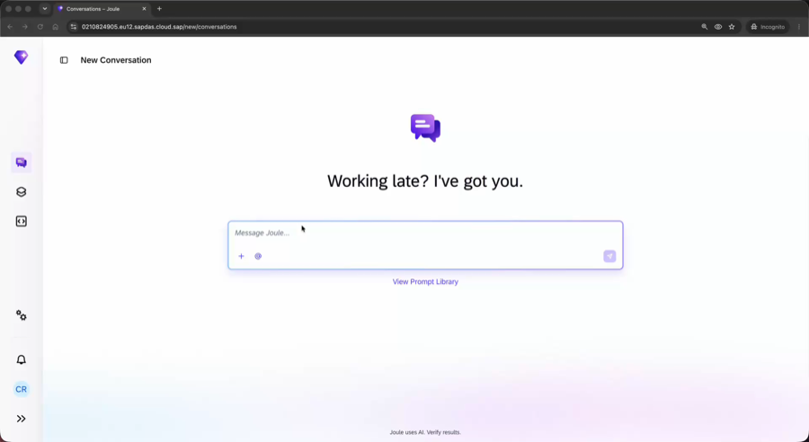
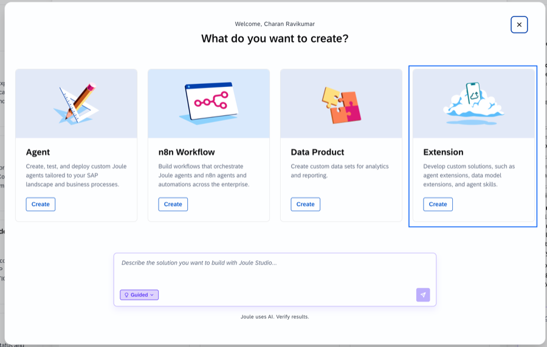
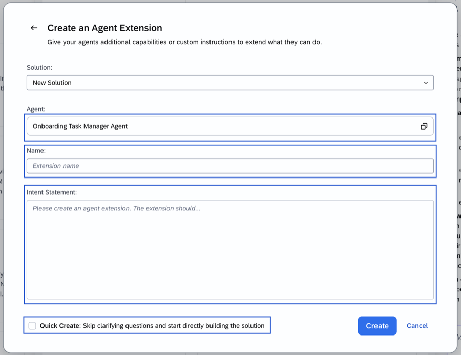
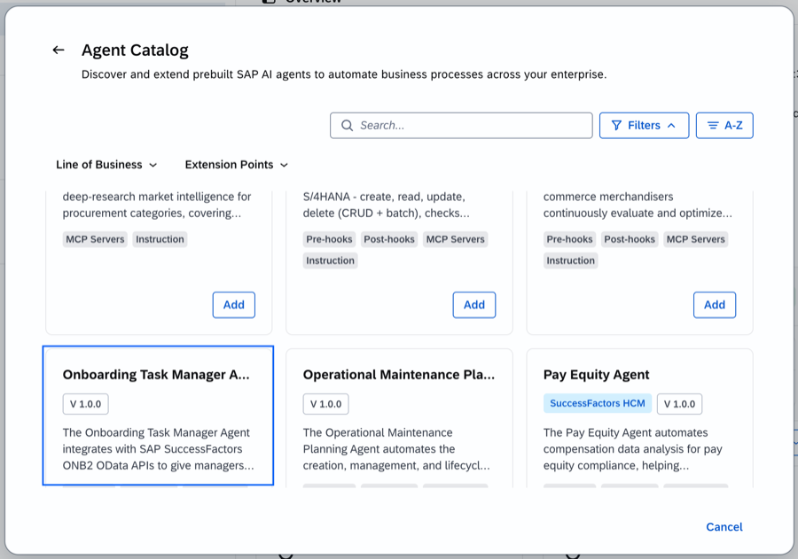
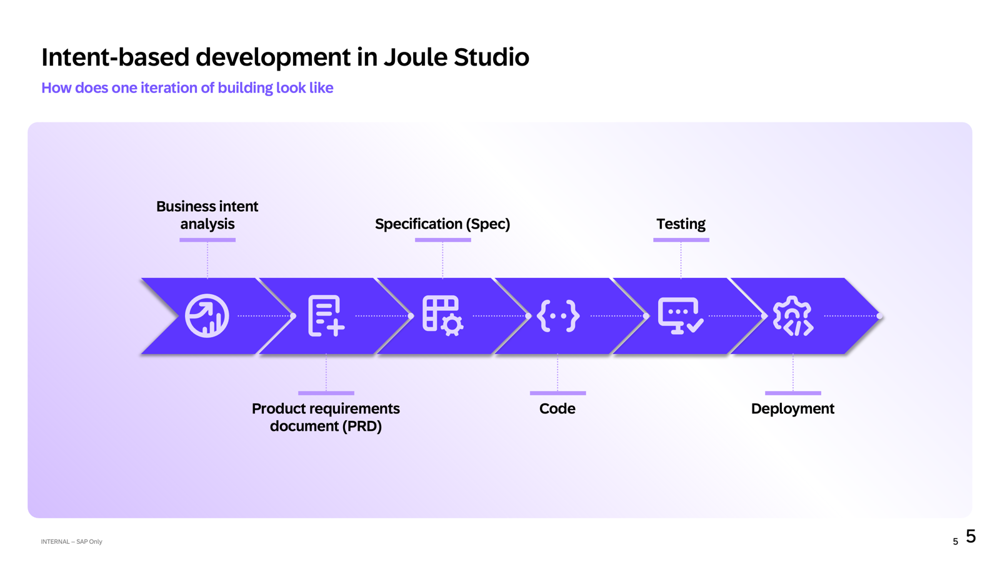
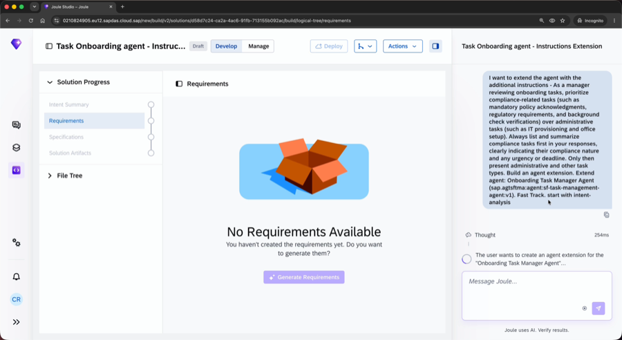
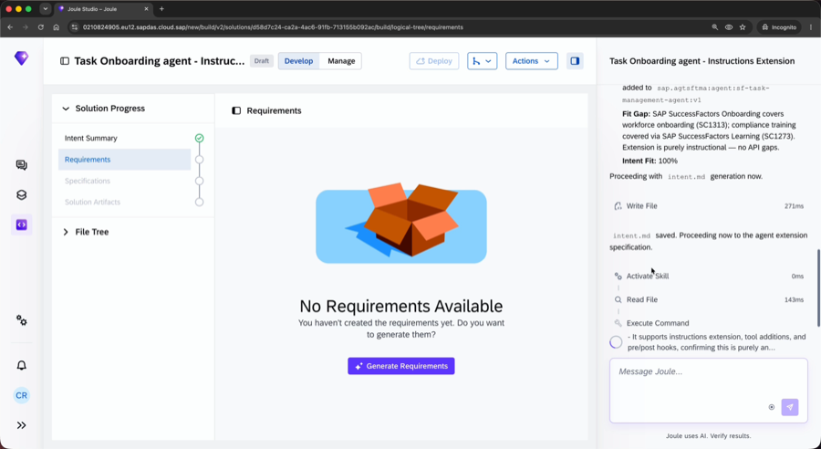
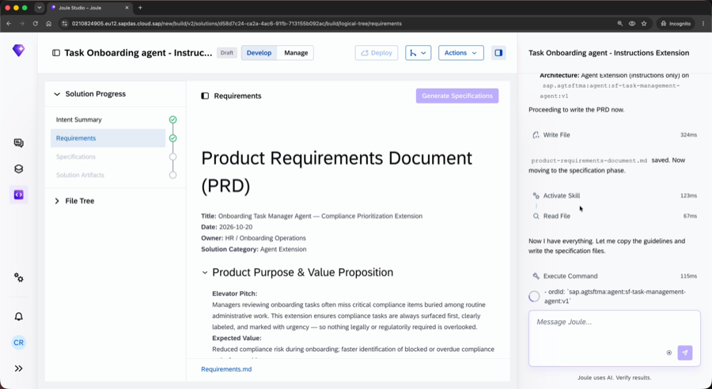
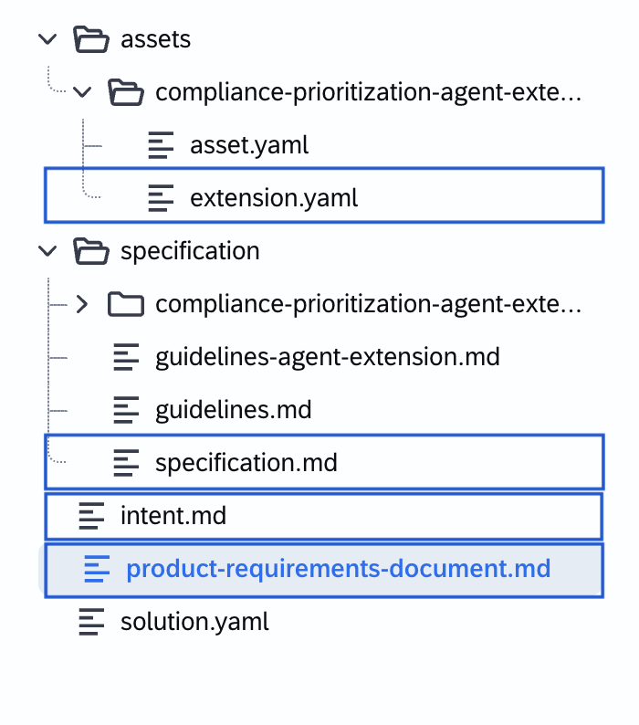
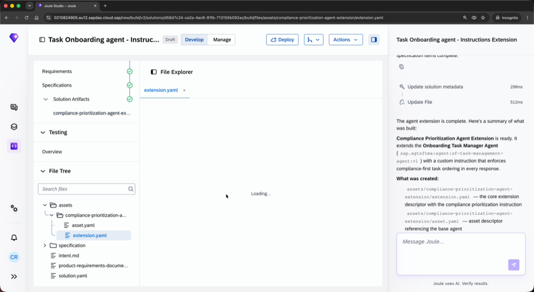

# Exercise 1 - Extend the Onboarding Task Manager Agent: Instruction Extension - Compliance Task Prioritization

In this exercise, you will create an **Instruction Extension** for the pre-delivered Onboarding Task Manager Agent using Joule Studio's Intent-Based Development (IBD) flow. The extension enforces that compliance-related onboarding tasks are always presented first — clearly labeled — whenever a manager reviews the onboarding task list.


### What you will build

An instruction extension that enforces the following behavior on every response from the Onboarding Task Manager Agent:

> **Compliance tasks are listed first, labeled `[COMPLIANCE]`, before administration or other task types.**

This is a direct manager need: when reviewing onboarding tasks for a new hire, the most business-critical items — data privacy acknowledgement, contract signing, security training enrollment — must be immediately visible, not buried beneath equipment orders or access requests.

### Why this matters

Onboarding task lists are long. A typical new hire onboarding plan contains 20–40 items spanning compliance, IT, HR administration, and logistics. Without prioritization, a manager reviewing the list in a busy week may miss a compliance deadline — triggering a policy violation, an audit finding, or a delayed start.

By building this as an **Instruction Extension**, the prioritization is enforced at the agent level — not through UI customization, filtering, or post-processing. Every response the Onboarding Task Manager Agent produces for a manager will reflect the rule, with no exceptions and no manual sorting required.

---

> [!IMPORTANT]
> **Every IBD run looks different — that is expected**
> IBD uses an LLM to interpret your intent, so the exact wording of clarifying questions, the order of steps, and the content of generated documents will vary between runs and between participants. Your session will not look identical to the screenshots in this guide. **Focus on the steps and the intent, not on matching the screenshots exactly.**

---

## Exercise 1.1 - Access Joule Studio and Initiate a New Extension

After completing these steps you will have opened Joule Studio and started creating a new Agent Extension targeting the Onboarding Task Manager Agent.

1. Log in to Joule Work at **[https://747238487.eu10.sapdas.cloud.sap/new/conversations/](https://747238487.eu10.sapdas.cloud.sap/new/conversations/)** using the credentials provided at your desk.

2. In the left navigation panel, select **Develop** to open Joule Studio.



3. On the Joule Studio home screen, click **+ New** and select **Extension** from the tile options.

   > The four options are Agent, n8n Workflow, Data Product, and Extension. An Extension lets you add capabilities or custom instructions to an existing pre-delivered SAP agent — without building a new agent from scratch.




4. The **Create an Agent Extension** dialog opens. Click the lookup icon next to the **Agent** field to open the Agent Catalog.




---

## Exercise 1.2 - Select the Target Agent from the Agent Catalog

After completing these steps you will have located the Onboarding Task Manager Agent in the Agent Catalog and reviewed its available extension points.

1. In the **Agent Catalog**, scroll to find the **Onboarding Task Manager Agent** (V 1.0.0). Click to select it.

   > The Agent Catalog lists all pre-delivered SAP agents that have been published as extensible. Only agents with the extensible flag enabled appear here. You can use the **Line of Business** and **Extension Points** filters to narrow the results.




2. The agent detail page opens. Review the **Agent Description** and its available **Extension Points**:
   - **Pre-hooks**, **Post-hooks**, **MCP Servers**, **Instruction** are all listed
   - Note the **Extended** badge — this agent already has an extension in this landscape

   Confirm that **Instruction** is listed as an available extension point, then click **Select Agent** to return to the extension form.


---

## Exercise 1.3 - Enter the Intent Statement and Create the Extension

After completing these steps you will have submitted your intent statement and triggered the Intent-Based Development flow in Joule Studio.

**What IBD does with your intent:**



When you click Create, Joule Studio runs this full pipeline automatically — from business intent analysis through to a deployable artifact. The clarifying questions and PRD steps you will complete in Exercises 1.4–1.6 are the middle stages of this flow.

1. Back in the **Create an Agent Extension** dialog, confirm that:
   - **Agent** is set to **Onboarding Task Manager Agent**
   - **Name** field shows **AD264-XXX** — replace **XXX** with your participant number (for example, AD264-001)
   - **Quick Create** is **NOT** checked

   > Leaving Quick Create off activates IBD, which walks you through a structured flow and produces a more accurate specification. Quick Create skips the clarifying questions and generates immediately.

2. In the **Intent Statement** field, enter the following text:

   ```
   As a manager reviewing onboarding tasks, I want the Onboarding Task Manager Agent
   to always prioritize compliance-related tasks over other task types (such as
   administration tasks) when presenting the onboarding task list. Compliance tasks
   must be listed first, clearly labeled, and must not be buried among administrative
   or logistical items.
   ```

   > [!WARNING]
   > **Fill in the Intent Statement before clicking Create.**
   > The Intent Statement field is required. Clicking **Create** with an empty field will produce an error. Paste the text above first, confirm it appears in the field, then click **Create**.


---

## Exercise 1.4 - Answer the Clarifying Questions

After completing these steps you will have provided the business context that Joule Studio uses to shape the extension specification.

1. Joule Studio creates the solution and begins the IBD (Intent Based Development) flow. You will see it execute a series of steps — Thought, Activate Skill, List Files, Read File — before surfacing the first clarifying question.

   > [!NOTE]
   > **IBD takes time — this is normal.**
   > The flow can take anywhere from 5 to 25 minutes depending on system load. There is no visible progress bar. If the screen appears frozen, wait — do not refresh the browser mid-flow as this will lose your session. If nothing has happened after 25 minutes, refresh the browser and reopen your solution from the Joule Studio home screen.




2. Joule will ask you one or more clarifying questions to better understand your intent.

   > [!NOTE]
   > These questions are generated dynamically by the LLM based on your intent statement. The exact wording and number of questions may differ each time. There are no fixed right or wrong answers — read each question and select or type the response that best reflects the goal of ensuring compliance tasks are always visible and prioritized for managers reviewing onboarding plans.

   The screenshots below show example questions you may encounter. Use them as a guide, not a script.




---

## Exercise 1.5 - Review the Intent Analysis and Confirm

After completing these steps you will have reviewed the Intent Analysis Summary generated by Joule Studio and confirmed the proposed extension design.

1. Joule Studio presents the **Intent Analysis Summary**. Review each section:

   | Section | Content |
   |---|---|
   | **Business Challenge** | Managers reviewing onboarding task lists cannot quickly identify compliance-critical items, increasing the risk of missed deadlines and policy violations |
   | **Business Goals & Success Criteria** | Compliance task visibility rate: 100% of manager-facing onboarding task responses, across all new hire onboarding plans |
   | **Business Architecture (RBA)** | End-to-End Process: Hire to Retire; Mapped Sub-Process: Onboard and integrate new employees |
   | **Fit Gap Analysis** | Standard Onboarding Task Manager Agent supports instructions — no tools or hooks needed; 100% fit |
   | **Recommended Solution** | Agent Extension: extend the Onboarding Task Manager Agent by adding a mandatory instruction that lists compliance tasks first and labels them `[COMPLIANCE]` in every task list response |

2. Review the **Recommended Solution** section at the bottom. When satisfied, type **confirm** in the input field and press Enter to proceed.


---

## Exercise 1.6 - Review the Product Requirements Document

After completing these steps you will have reviewed the generated PRD and confirmed the specification so Joule Studio can build the extension artifacts.

1. Joule Studio generates the **intent.md** file, visible in the File Explorer. On the right panel, review the **Product Requirements Document Summary**:

   - **Solution Category**: Agent Extension
   - **User Personas**: Hiring Manager (onboarding oversight), HR Business Partner (compliance audit)
   - **Key Requirements**: Every task list response from the Onboarding Task Manager Agent must present compliance tasks first; each compliance task must carry the `[COMPLIANCE]` prefix label; applied consistently with no exceptions
   - **Solution Architecture**: Pure instruction extension — no tools, hooks, or APIs required

2. Type **confirm** in the input field and press Enter to trigger artifact generation.




---

## Exercise 1.7 - Review the Generated Artifact

After completing these steps you will have inspected the generated `extension.yaml` artifact and the full solution file tree.

1. The File Explorer updates to show the generated artifacts. Review the file structure:




2. Open **assets > compliance-prioritization-agent-extension > extension.yaml**. Review its content:

   ```yaml
   schema-version: "0.1.0"
   kind: Extension

   metadata:
     name: "compliance-prioritization-agent-extension"

   agent:
     id: "sap.agtsftma:agent:sf-task-management-agent:v1"

   capabilityImplementations:
     - capabilityStyleId: "do_unit"
       subAbilities: []
       protocolVersion: 1
       instructions:
         - As a manager reviewing onboarding tasks, prioritize compliance-related
           tasks (such as mandatory policy acknowledgments, regulatory requirements,
           and background check verifications) over administrative tasks (IT
           provisioning and office setup). Always list and summarize compliance
           tasks first in your responses, clearly indicating their compliance
           nature and any urgency or deadline. Only then present administrative
           and other task types.
   ```

   > Joule Studio generates this artifact automatically from your intent statement. The `instructionSupported: true` flag on the agent means the prioritization rule is enforced directly as an extension instruction — no tools or hooks are needed.




> [!CAUTION]
> **Stop here — do not click Deploy**
> Deployment requires the **Joule Studio Administrator** role, which participants do not hold in this workshop environment. **Do not select the Deploy button.**
>
> **One extension per agent, per tenant.** Only one extension can be active on an agent at a time. Deploying your individual extension would overwrite every other participant's work on the shared tenant. This is why deployment is handled exclusively by the facilitator.
>
> Your facilitator will deploy a single shared extension and demonstrate the Onboarding Task Manager Agent running live with compliance task prioritization. You will see the deployed runtime on the facilitator's screen.

---

## Summary

You have created an Instruction Extension for the pre-delivered Onboarding Task Manager Agent using Joule Studio's Intent-Based Development flow. Starting from a plain language intent statement, Joule Studio:

1. Asked targeted clarifying questions to understand your business goal
2. Produced a structured Intent Analysis Summary and PRD
3. Generated a deployable `extension.yaml` artifact — with no manual YAML editing required

Your facilitator will now deploy the extension and demonstrate the Onboarding Task Manager Agent presenting compliance tasks first — labeled `[COMPLIANCE]` — in every manager-facing task list response.

This is the simplest form of an agent extension — a single instruction with no tools or hooks. In the next exercise, you will see how the same Onboarding Task Manager Agent can be extended with a 3rd-party tool integration, connecting it to SAP Ariba to automatically raise equipment procurement requests directly from the onboarding context.

---

## Facilitator Deployment — Watch and Then Try the Agent

After you complete Exercise 1.7, the facilitator will deploy the extension live. This step has two parts: watching the deployment happen, then returning to the agent yourself to see the difference.

### Watch the facilitator deploy

1. The facilitator will share their screen and open **Joule Studio > Agent Hub**.
2. They will select the compliance-prioritization extension and click **Deploy**.
3. Watch the status indicator change — wait until it shows **Active** or **Running** before proceeding.

   > This is the step participants cannot perform on the shared tenant. One extension can be active per agent at a time — having the facilitator deploy a single shared extension means every participant sees the same live result.

---

### While You Wait — Open Discussion

Deployment takes a few minutes. The facilitator will kick off the conversation — no preparation needed, just raise your hand or shout out an answer.

---

**Round 1 — Show of hands**

- Who has used **Joule** before today — in any form, any product?
- Who has interacted with a **pre-delivered SAP agent** — not built one, just used one?
- Who has already tried to **extend or configure** an SAP agent in their landscape?

---

**Round 2 — If you have used a pre-delivered agent**

- Which one? What did you use it for?
- Did it do what you needed out of the box — or did you hit a wall?
- What was the wall? Missing data, wrong tone, wrong language, missing a system connection?

---

**Round 3 — What does "extension" actually mean to you?**

Before today, if someone said "we need to extend the Joule agent" — what did that mean in your head?

> Some common answers we hear:
> - "Rebuild it from scratch"
> - "Ask SAP to change it"
> - "Add a custom field somewhere"
> - "Write a BTP app around it"
>
> None of those are wrong — but what you just did in this exercise is different from all of them. You changed agent behavior without touching the source, without a BTP app, and without filing a support ticket. That gap between expectation and reality is worth naming.

---

**Round 4 — Your landscape**

- Is there a process in your company where an agent *almost* works but needs one rule added — a language, a policy, a label?
- Who in your organization would make the decision to extend a pre-delivered SAP agent — an architect, a product owner, IT, the business?

> [!NOTE]
> There are no right answers. Facilitators are circulating — flag one down if you want to talk through a specific scenario from your own landscape.

---

### Try the Agent Again — After the Extension

Now repeat the same prompts from Exercise 0 and compare the output directly.

**How to start a fresh conversation:**

1. Go back to Joule Work (same URL as before).
2. Start a **new conversation** with the Onboarding Task Manager Agent.

   > Starting a new conversation is important — an existing session may return cached responses that do not reflect the newly deployed extension.

**Send these three prompts** (same new hire as in Exercise 0):

**Prompt 1**
```
Show tasks for [New Hire]
```

**Prompt 2**
```
Show today's priority for [New Hire]
```

**Prompt 3**
```
Show tasks overdue in next 1 week for [New Hire]
```

**What to look for:**

- Do compliance tasks now appear **first** in the list?
- Are they labeled `[COMPLIANCE]`?
- Compare the ordering and labeling directly against what you saw in Exercise 0 — the instruction extension is responsible for every difference you notice.

**Bonus prompt if you have time:**
```
Show critical tasks for [New Hire]
```

---

Continue to - [Exercise 2 - Extend the Onboarding Task Manager Agent: MCP Extension – SAP Ariba Equipment Ordering](../ex2/README.md)
