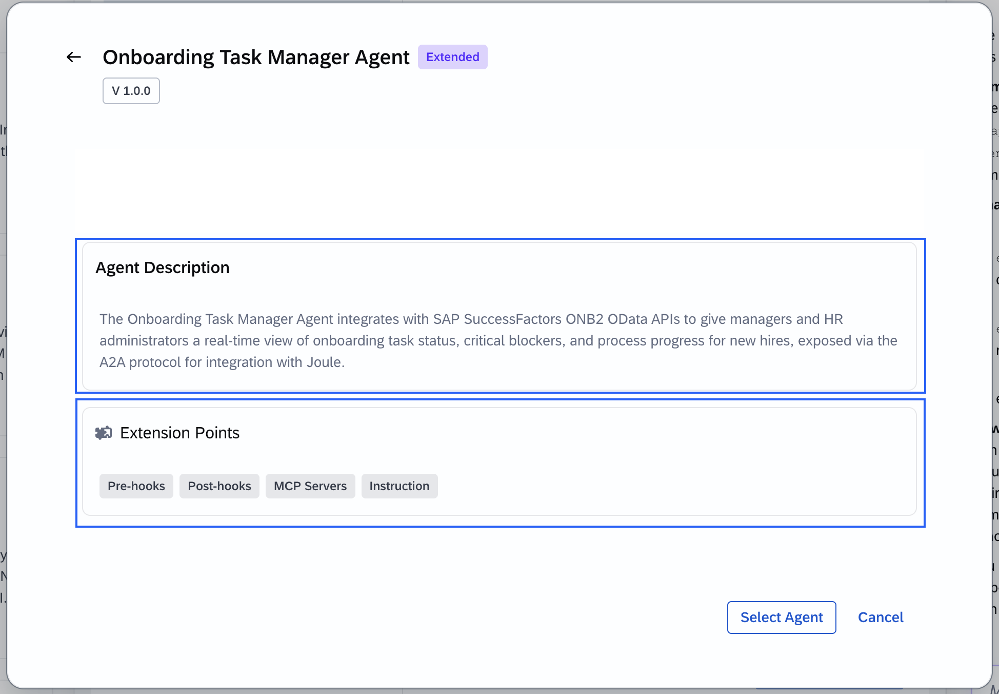
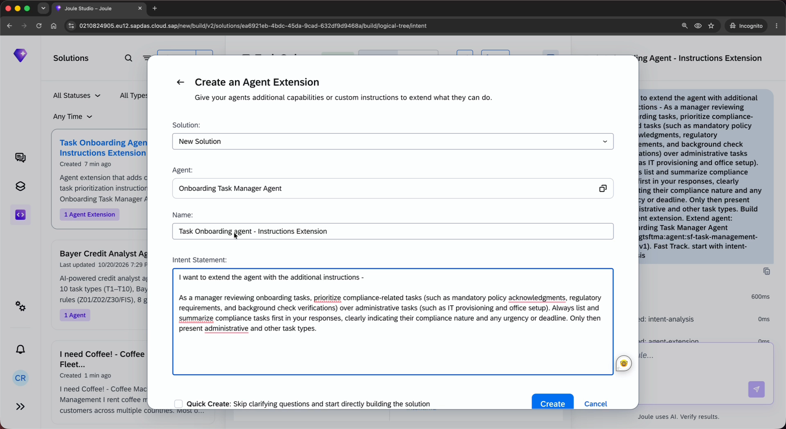
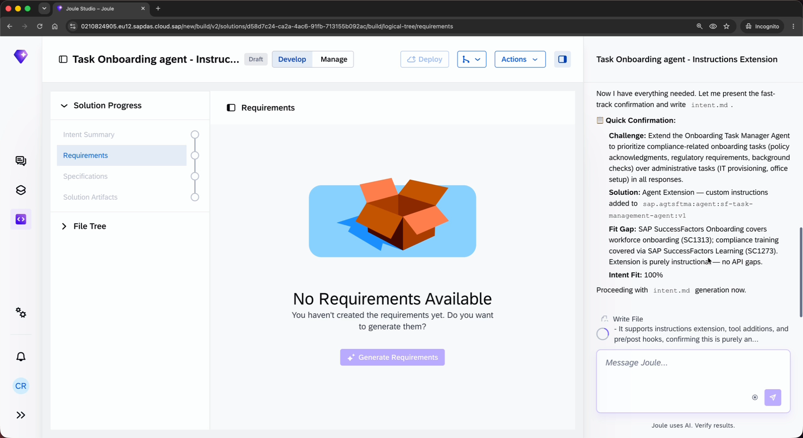
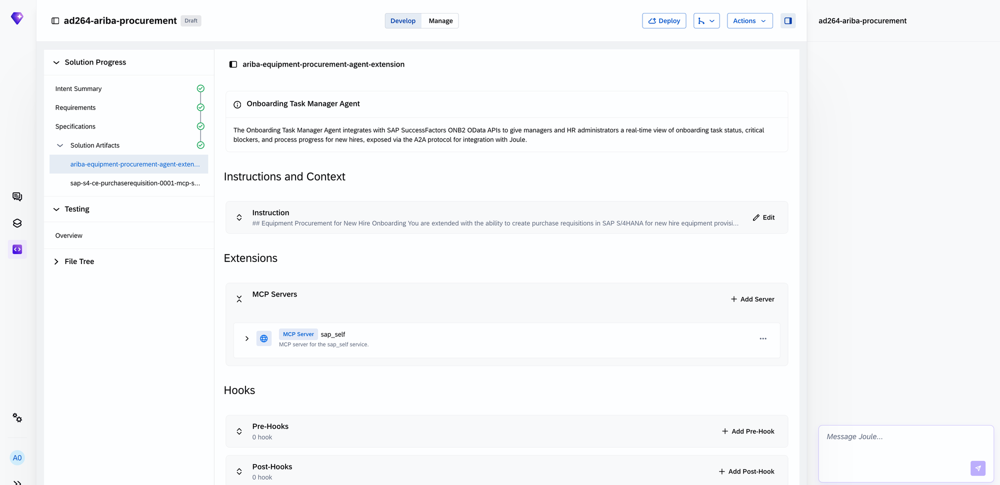
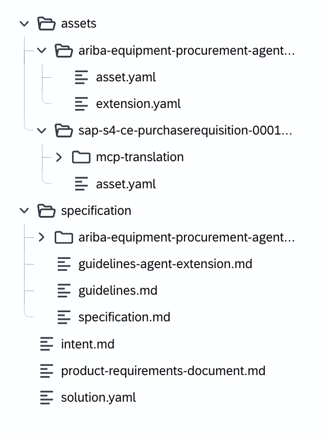

# Exercise 2 - Extend the Onboarding Task Manager Agent: MCP Extension – SAP Ariba Equipment Ordering

In this exercise, you will create an **MCP Extension** for the pre-delivered Onboarding Task Manager Agent using Joule Studio's Intent-Based Development (IBD) flow. The extension connects the agent to SAP Ariba via an MCP server, enabling it to raise equipment procurement requests directly from the onboarding context — without switching systems or copying data.

### What you will build

An MCP extension that gives the Onboarding Task Manager Agent the ability to:

> **Identify equipment provisioning tasks at risk, determine what equipment is required, raise a procurement request in SAP Ariba, and return the requisition status back to the onboarding task.**

This closes a real Day 1 gap: when a new hire's equipment is not ordered in time, their first day is disrupted. Today that requires a manager to manually identify the gap, open Ariba, create a requisition, then update the task — four steps across two systems. This extension collapses it to one conversation.

### The user story

> As a manager reviewing onboarding tasks, I want the Onboarding Task Manager Agent to identify when an equipment provisioning task is at risk for an upcoming new hire, determine what equipment is needed, raise a procurement request in SAP Ariba, and return the requisition status — so that Day 1 readiness is not blocked by a missing equipment order.

### What an MCP Extension adds

Exercise 1 used an **Instruction Extension** — a plain-language rule injected into the agent's prompt, no external calls required. This exercise uses an **MCP Extension**, which is different:

| | Instruction Extension | MCP Extension |
|---|---|---|
| What it adds | A rule the agent follows | A tool the agent can call |
| External systems | None | SAP Ariba (via MCP server) |
| Runtime behavior | Agent follows the instruction on every response | Agent decides when to invoke the tool based on context |
| When to use | Behavior changes, response formatting, policies | Retrieving data, creating records, executing actions |

### Where your extension reaches


An MCP Extension uses the **Agent Gateway → MCP Server** path in this architecture. When the agent decides it needs to act in an external system, it routes the call through the Agent Gateway to the registered MCP server — in this exercise, the SAP S/4HANA purchase requisition service. The result comes back to the agent, which surfaces it in the conversation. Your instruction layer (also part of this extension) governs *when* and *how* that call is made.

---

> [!NOTE]
> **Every IBD run looks different — that is expected**
> IBD uses an LLM to interpret your intent, so the exact wording of clarifying questions, the order of steps, and the content of generated documents will vary between runs and between participants. Your session will not look identical to the screenshots in this guide. **Focus on the steps and the intent, not on matching the screenshots exactly.**

---

## Exercise 2.1 - Select the Target Agent from the Agent Catalog

After completing these steps you will have located the Onboarding Task Manager Agent in the Agent Catalog and confirmed that MCP Servers is an available extension point.

1. In the **Agent Catalog**, scroll to find the **Onboarding Task Manager Agent** (V 1.0.0). Click to select it.

   > Use the **Extension Points** filter and select **MCP Servers** to narrow the catalog to agents that support tool integrations.

<br>

2. The agent detail page opens. Review the **Extension Points** listed:
   - **Pre-hooks**, **Post-hooks**, **MCP Servers**, **Instruction** are all available

   Confirm that **MCP Servers** is listed, then click **Select Agent** to return to the extension form.

<br>

---

## Exercise 2.2 - Enter the Intent Statement and Create the Extension

After completing these steps you will have submitted your intent statement and triggered the Intent-Based Development flow in Joule Studio.

**What IBD does with your intent:**


The same pipeline runs for an MCP extension — Joule Studio will additionally ask questions about which tools are needed, what data flows between the agent and Ariba, and what the approval gate should look like.

1. Back in the **Create an Agent Extension** dialog, confirm that:
   - **Agent** is set to **Onboarding Task Manager Agent**
   - **Name** field shows **AD264-XXX** — replace **XXX** with your participant number (for example, AD264-001)
   - **Quick Create** is **NOT** checked

   > Leaving Quick Create off activates IBD. For an MCP extension, the structured flow matters more than for a simple instruction — IBD will ask questions about which tools are needed, what data the agent should pass to Ariba, and what the approval flow should look like.

2. In the **Intent Statement** field, enter the following text:

   ```
   As a manager reviewing onboarding tasks, I want the Onboarding Task Manager Agent
   to identify when an equipment provisioning task is at risk for an upcoming new hire,
   determine the equipment required based on the onboarding context, and raise a
   procurement request in SAP Ariba via an MCP tool. The agent should present the
   proposed order to me for approval before executing. Once approved, the Ariba MCP
   tool should create the procurement request and return the requisition ID and status
   so the onboarding task can be marked as on track.
   ```

   > [!WARNING]
   > **Fill in the Intent Statement before clicking Create.**
   > The Intent Statement field is required. Clicking **Create** with an empty field will produce an error. Paste the text above first, confirm it appears in the field, then click **Create**.
   ```

<br>

---

## Exercise 2.3 - Answer the Clarifying Questions

After completing these steps you will have provided the business context that Joule Studio uses to shape the MCP extension specification.

1. Joule Studio creates the solution and begins the IBD flow. You will see it execute a series of internal steps before surfacing the first clarifying question.

   > [!NOTE]
   > **IBD takes time — this is normal.**
   > The flow can take anywhere from 5 to 25 minutes depending on system load. There is no visible progress bar. If the screen appears frozen, wait — do not refresh the browser mid-flow as this will lose your session. If nothing has happened after 25 minutes, refresh the browser and reopen your solution from the Joule Studio home screen.

<br>

2. Joule will ask clarifying questions to understand the tool integration. Questions may include:

   - What approval gate is required before the Ariba request is created?
   - Should the agent present a cost estimate before executing?
   - What information should be returned to the onboarding task once the requisition is created?

   > **Note:** These questions are generated dynamically. Read each question and respond based on the goal: a human-approved, Ariba-backed equipment order that returns a requisition ID to the onboarding context. There are no fixed right or wrong answers.

<br>

---

## Exercise 2.4 - Review the Intent Analysis and Confirm

After completing these steps you will have reviewed the Intent Analysis Summary and confirmed the proposed MCP extension design.

1. Joule Studio presents the **Intent Analysis Summary**. Review each section:

   | Section | Content |
   |---|---|
   | **Business Challenge** | Equipment provisioning tasks for new hires are missed or delayed because there is no automated path from the onboarding task to a procurement request in Ariba |
   | **Business Goals & Success Criteria** | Day 1 equipment readiness rate: 100% of new hires with an equipment provisioning task have a requisition raised before their start date |
   | **Business Architecture (RBA)** | End-to-End Process: Hire to Retire; Mapped Sub-Process: Onboard and integrate new employees |
   | **Fit Gap Analysis** | Onboarding Task Manager Agent supports MCP Servers extension point; SAP Ariba MCP server available in this landscape; approval gate requires an instruction layer alongside the MCP tool |
   | **Recommended Solution** | MCP Extension: connect the Onboarding Task Manager Agent to the SAP Ariba MCP server for procurement request creation; add an instruction requiring user approval before execution |

2. Review the **Recommended Solution** section. When satisfied, type **confirm** in the input field and press Enter to proceed.

---

## Exercise 2.5 - Review the Product Requirements Document

After completing these steps you will have reviewed the generated PRD and confirmed the specification so Joule Studio can build the extension artifacts.

1. On the right panel, review the **Product Requirements Document**:

   - **Solution Category**: Agent Extension (MCP + Instruction)
   - **User Personas**: Hiring Manager (onboarding oversight), Procurement Approver (Ariba)
   - **Key Requirements**:
     - Agent identifies at-risk equipment provisioning tasks proactively
     - Agent determines required equipment from onboarding context (role, location, hire type)
     - Agent presents proposed order with estimated cost before executing
     - Ariba MCP tool creates the procurement request after explicit user approval
     - Requisition ID and status returned to the agent and surfaced in the onboarding task context
   - **Solution Architecture**: MCP Extension (Ariba tool) + Instruction Extension (approval gate rule)

2. Type **confirm** in the input field and press Enter to trigger artifact generation.

<br>

---

## Exercise 2.6 - Review the Generated Artifacts

After completing these steps you will have inspected the generated extension artifacts, including the MCP server configuration and the extension.yaml.

1. The **Solution Artifacts** panel updates. In the left panel under **Solution Artifacts**, you will see two entries:
   - **ariba-equipment-procurement-agent-extension** — the core extension wiring instruction and MCP server to the Onboarding Task Manager Agent
   - **sap-s4-ce-purchaserequisition-0001-mcp-s...** — the SAP S/4HANA purchase requisition MCP server asset

   Select **ariba-equipment-procurement-agent-extension** to open it. Review the two sections:

   - **Instructions and Context** — the `Instruction` row shows the equipment procurement rule the agent will follow. Click to expand it and read the full instruction text.
   - **Extensions** — the `MCP Servers` row shows **sap_self** wired as the MCP server. This is the SAP S/4HANA purchase requisition service the agent will call to create the procurement request.

<br>

2. Open the **File Tree** to review the generated file structure. You will see:

   | Path | Purpose |
   |---|---|
   | `assets/ariba-equipment-procurement-agent-extension/extension.yaml` | Core extension descriptor — wires instruction and MCP server to the agent |
   | `assets/ariba-equipment-procurement-agent-extension/asset.yaml` | Asset descriptor referencing the Onboarding Task Manager Agent |
   | `assets/sap-s4-ce-purchaserequisition-0001.../asset.yaml` | MCP server asset descriptor for the S/4HANA purchase requisition service |
   | `assets/sap-s4-ce-purchaserequisition-0001.../mcp-translation/` | MCP tool translation files mapping Ariba operations to the agent |
   | `specification/intent.md` | Captured intent statement |
   | `specification/product-requirements-document.md` | Generated PRD |
   | `specification/solution.yaml` | Solution metadata |

<br>

3. Open **assets > ariba-equipment-procurement-agent-extension > extension.yaml**. The key structure to note:

   ```yaml
   schema-version: "0.1.0"
   kind: Extension

   metadata:
     name: "ariba-equipment-procurement-agent-extension"

   agent:
     id: "sap.agtsftma:agent:sf-task-management-agent:v1"

   capabilityImplementations:
     - capabilityStyleId: "do_unit"
       subAbilities: []
       protocolVersion: 1
       instructions:
         - "## Equipment Procurement for New Hire Onboarding
            You are extended with the ability to create purchase requisitions
            in SAP S/4HANA for new hire equipment provisioning..."
       mcpServers:
         - name: "sap_self"
           description: "MCP server for the sap_self service"
   ```

   > The key difference from Exercise 1 is the `mcpServers` block. This wires the SAP S/4HANA purchase requisition service as a callable tool. The `instructions` block remains — it enforces the approval gate and tells the agent *when* and *how* to use the tool. Together they form a complete MCP extension: a rule that governs behaviour, and a tool that acts on it.

---

## Exercise 2.7 - Understand the Runtime Flow

Before the facilitator demonstration, review the end-to-end flow your extension enables:

**POC flow — creating a specific task:**

```
Manager: "I have a new hire, Oscar Lang, joining on 15 Nov. Create a new task 'Raise Laptop Request'."

Agent:   Identifies the equipment provisioning task.
         Invokes the Ariba extension with Oscar's onboarding context.

Ariba:   Creates the procurement requisition.
         Returns requisition ID: REQ-2026-004821

Agent:   "Task 'Raise Laptop Request' created and marked complete.
          Ariba requisition REQ-2026-004821 has been raised for Oscar Lang's laptop."
```

**Full flow — proactive at-risk detection:**

```
Manager: "What onboarding tasks are at risk for next week's new hires?"

Agent:   Identifies Priya's equipment provisioning task as pending — Day 1 is in 6 days.
         Determines required equipment from onboarding context: laptop, monitor, headset.

Agent:   "A laptop, monitor and headset are required for Priya (start date: 27 Oct).
          Estimated cost: $2,340. Create the procurement request?"

Manager: "Yes, go ahead."

Agent:   Invokes Ariba MCP tool → createRequisition
Ariba:   Returns REQ-2026-004822, status: Pending Approval

Agent:   "Done. Ariba requisition REQ-2026-004822 raised for Priya's equipment.
          Status: Pending Approval. Onboarding task updated — Day 1 readiness on track."
```

---

> [!WARNING]
> **Stop here — do not click Deploy**
> Deployment requires the **Joule Studio Administrator** role, which participants do not hold in this workshop environment. **Do not select the Deploy button.**
>
> **One extension per agent, per tenant.** Only one extension can be active on an agent at a time. Deploying your individual extension would overwrite every other participant's work on the shared tenant. This is why deployment is handled exclusively by the facilitator.
>
> Your hands-on work is complete: you have built the MCP extension and reviewed all generated artifacts.

---

## Summary

You have created an MCP Extension for the pre-delivered Onboarding Task Manager Agent using Joule Studio's Intent-Based Development flow. Starting from a plain language intent statement, Joule Studio:

1. Asked targeted clarifying questions to understand the tool integration and approval requirements
2. Produced a structured Intent Analysis Summary and PRD
3. Generated a deployable `extension.yaml` with both an MCP server configuration and an approval gate instruction — with no manual YAML editing required

Compared to Exercise 1, this extension adds a live Ariba tool integration. The agent no longer just follows a rule — it can now take action in an external system, retrieve real data, and return it to the onboarding context.

> [!NOTE]
> **Current GA scope for MCP Extensions**
>
> 
>
> At GA, only Instruction Extensions support full deployment and live runtime in this environment. MCP Extensions are EAC scope — the full creation flow is hands-on but deployment is not available. The runtime flow in Exercise 2.7 illustrates what the deployed extension would do; your facilitator will walk through it on screen.

Continue to - [Exercise 3 ★ Bonus — Extend the Onboarding Task Manager Agent: Pre-Hook & Post-Hook](../ex3/README.md)
