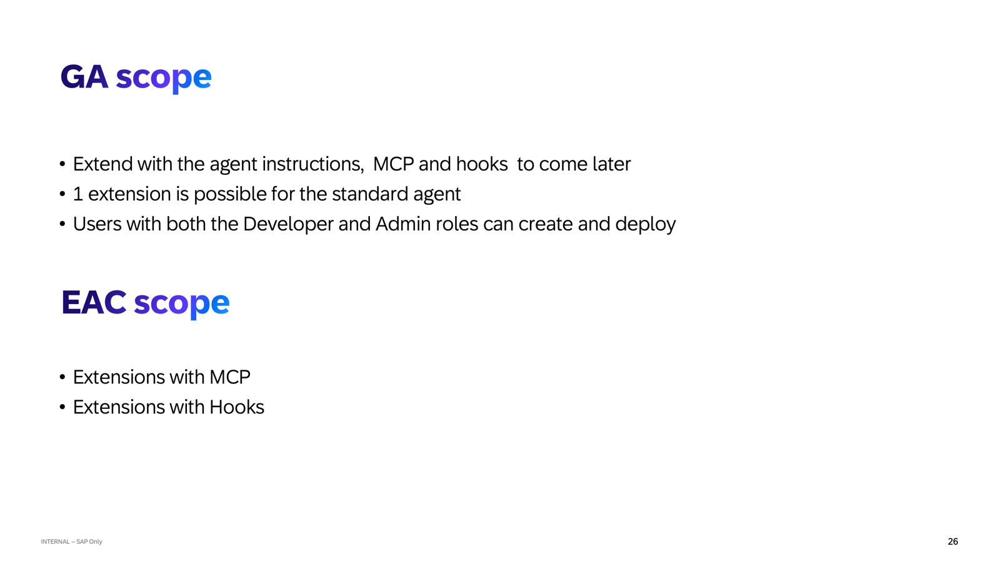

# Exercise 3 ★ Bonus — Extend the Onboarding Task Manager Agent: Pre-Hook & Post-Hook

This is a bonus exercise. It is not required to complete the session — but if you have finished Exercises 1 and 2 and want to go further, this is where extensions get more powerful.

In Exercises 1 and 2 you extended the agent's behaviour with instructions and tools. Both of those operate *during* the agent's response. Hooks are different — they let you intercept what happens *before* the agent starts and *after* it finishes. This exercise builds both.

---

### What you will build

Two hooks on the Onboarding Task Manager Agent:

**Pre-Hook — Onboarding Readiness Gate**
> Before the agent processes any request, check whether the new hire's onboarding record is complete and active in SAP SuccessFactors. If the record is missing or in a draft state, block the request and return a clear message rather than letting the agent attempt to operate on incomplete data.

**Post-Hook — Teams Notification on Task Completion**
> After the agent marks an onboarding task as complete, automatically send a notification to the hiring manager's Teams channel with the task name, new hire name, and completion timestamp — so the manager is informed without needing to check the system.

---

### Why hooks exist

| Extension type | When it runs | What it can do |
|---|---|---|
| Instruction | During the agent response | Change how the agent reasons and responds |
| MCP Server | During the agent response | Give the agent tools to call external systems |
| **Pre-Hook** | **Before the agent starts** | **Validate input, enrich context, block execution** |
| **Post-Hook** | **After the agent responds** | **Trigger follow-on actions, notify, log, transform output** |

Hooks run as n8n workflows. They are not part of the agent's reasoning loop — they are external processes that wrap it. The agent never sees the hook code; it only sees the enriched input (pre-hook) or runs before the follow-on action fires (post-hook).

### The user story

> As an HR administrator, I want the Onboarding Task Manager Agent to verify that a new hire's onboarding record exists and is active before processing any request — and to automatically notify the hiring manager in Teams whenever an onboarding task is marked complete — so that the agent only operates on valid data and managers are kept informed without manual follow-up.

---

> [!IMPORTANT]
> **Every IBD run looks different — that is expected**
> IBD uses an LLM to interpret your intent, so the exact wording of clarifying questions, the order of steps, and the content of generated documents will vary between runs and between participants. Your session will not look identical to the screenshots in this guide. **Focus on the steps and the intent, not on matching the screenshots exactly.**

---

## Exercise 3.1 - Select the Target Agent from the Agent Catalog

After completing these steps you will have located the Onboarding Task Manager Agent in the Agent Catalog and confirmed that Pre-hooks and Post-hooks are available extension points.

1. Return to Joule Work at **[https://747238487.eu10.sapdas.cloud.sap/new/conversations/](https://747238487.eu10.sapdas.cloud.sap/new/conversations/)** — you should still be logged in from the previous exercises.

2. In the left navigation panel, select **Develop** to open Joule Studio.

3. On the Joule Studio home screen, click **+ New** and select **Extension** from the tile options.

4. The **Create an Agent Extension** dialog opens. Click the lookup icon next to the **Agent** field to open the Agent Catalog.

5. In the **Agent Catalog**, scroll to find the **Onboarding Task Manager Agent** (V 1.0.0). Click to select it.

6. The agent detail page opens. Review the **Extension Points** listed:
   - **Pre-hooks**, **Post-hooks**, **MCP Servers**, **Instruction** are all available

   Confirm that both **Pre-hooks** and **Post-hooks** are listed, then click **Select Agent** to return to the extension form.

---

## Exercise 3.2 - Enter the Intent Statement and Create the Extension

After completing these steps you will have submitted your intent and triggered the IBD flow for a hooks-based extension.

**What IBD does with your intent:**


For hooks, IBD generates n8n workflow files rather than just instructions — the pipeline is the same but the artifacts it produces at the Code and Deployment stages are workflow definitions rather than a plain `extension.yaml`.

1. Back in the **Create an Agent Extension** dialog, confirm:
   - **Agent** is set to **Onboarding Task Manager Agent**
   - **Name** is **AD264-XXX** — replace **XXX** with your participant number
   - **Quick Create** is **NOT** checked

2. In the **Intent Statement** field, enter the following text:

   ```
   Before the Onboarding Task Manager Agent processes any request, use a pre-hook
   to verify that the new hire's onboarding record exists and is active in SAP
   SuccessFactors. If the record is missing or in a draft state, block the request
   and return a message explaining why the agent cannot proceed.

   After the agent marks any onboarding task as complete, use a post-hook to send
   a Teams notification to the hiring manager with the task name, the new hire's
   name, and the completion timestamp.
   ```

   > [!WARNING]
   > **Fill in the Intent Statement before clicking Create.**
   > The Intent Statement field is required. Clicking **Create** with an empty field will produce an error. Paste the text above first, confirm it appears in the field, then click **Create**.

---

## Exercise 3.3 - Answer the Clarifying Questions

After completing these steps you will have provided the context IBD needs to generate both hook workflows.

1. Joule Studio begins the IBD flow. Because this intent involves workflow logic rather than just instructions or tools, IBD may ask more detailed clarifying questions than in previous exercises.

   > [!NOTE]
   > **IBD takes time — this is normal.**
   > The flow can take anywhere from 5 to 25 minutes depending on system load. There is no visible progress bar. If the screen appears frozen, wait — do not refresh the browser mid-flow as this will lose your session. If nothing has happened after 25 minutes, refresh the browser and reopen your solution from the Joule Studio home screen.

   Examples you may encounter:

   **Pre-hook questions:**
   - What SuccessFactors API or data field should be checked to determine whether the record is active?
   - Should the check apply to all requests, or only those that reference a specific new hire?
   - What message should the agent return if the record is missing?

   **Post-hook questions:**
   - Which Teams channel or recipient should receive the notification?
   - Should the notification fire on every task completion, or only for specific task types?
   - What information should be included in the Teams message body?

   > [!NOTE]
   > Answer based on the goal — a SuccessFactors record check that blocks bad requests, and a Teams notification that keeps managers informed. There are no fixed right or wrong answers.

2. After all clarifying questions, Joule presents the **Intent Analysis Summary**. Review it to confirm both hooks are captured:

   | Section | What to check |
   |---|---|
   | **Business Challenge** | Should mention both the risk of operating on incomplete data and the lack of automatic manager notification |
   | **Recommended Solution** | Should list two artifacts: a pre-hook workflow (SuccessFactors validation) and a post-hook workflow (Teams notification) |
   | **Fit Gap Analysis** | Should confirm that both Pre-hooks and Post-hooks are available on this agent |

   When satisfied, type **confirm** and press Enter.

---

## Exercise 3.4 - Review the Product Requirements Document

After completing these steps you will have reviewed the PRD covering both hook requirements and confirmed it to trigger artifact generation.

1. Review the **PRD** on the right panel. Key things to look for:

   - **Pre-hook requirement**: the workflow must query SuccessFactors, evaluate the record status, and return a blocking response if the check fails — *before* the agent processes the request
   - **Post-hook requirement**: the workflow must extract the completed task name and new hire name from the agent's response context, format a Teams message, and dispatch it — *after* the agent has responded
   - **Solution Architecture**: two n8n workflows, one wired as a pre-hook and one as a post-hook, with no changes to the base agent's instruction or tools

2. Type **confirm** and press Enter to trigger artifact generation.

---

## Exercise 3.5 - Review the Generated Hook Artifacts

After completing these steps you will have inspected the generated n8n workflow files and the extension.yaml wiring both hooks to the agent.

1. The **Solution Artifacts** panel shows the generated extension. Select it to open the artifact view. Review the **Hooks** section — you should see:

   - **Pre-Hooks** — one entry wired to the SuccessFactors validation workflow
   - **Post-Hooks** — one entry wired to the Teams notification workflow

   > In Exercises 1 and 2 the extension contained Instructions and MCP Servers. Hooks appear in a separate **Hooks** section of the same artifact view, below Extensions.

2. Open the **File Tree** and locate the generated artifacts. The structure will include:

   | Path | Purpose |
   |---|---|
   | `assets/<extension-name>/extension.yaml` | Wires both hooks to the agent |
   | `assets/<extension-name>/asset.yaml` | Asset descriptor referencing the Onboarding Task Manager Agent |
   | `assets/<pre-hook-workflow>/workflow.json` | n8n workflow — SuccessFactors record validation |
   | `assets/<post-hook-workflow>/workflow.json` | n8n workflow — Teams notification on task completion |
   | `specification/intent.md`, `product-requirements-document.md` | Planning documents |

3. Open **extension.yaml** and review the hooks wiring:

   ```yaml
   schema-version: "0.1.0"
   kind: Extension

   metadata:
     name: "onboarding-hooks-extension"

   agent:
     id: "sap.agtsftma:agent:sf-task-management-agent:v1"

   capabilityImplementations:
     - capabilityStyleId: "do_unit"
       subAbilities: []
       protocolVersion: 1
       preHooks:
         - name: "sf-onboarding-record-validation"
           description: "Validates that the new hire's onboarding record exists
             and is active in SAP SuccessFactors before the agent processes
             the request"
       postHooks:
         - name: "teams-task-completion-notification"
           description: "Sends a Teams notification to the hiring manager when
             an onboarding task is marked complete"
   ```

   > Notice what is absent: there is no `instructions` block and no `mcpServers` block. This extension does nothing to the agent's reasoning — it only wraps it. The agent behaves identically to a standard Onboarding Task Manager Agent; the hooks handle everything before and after.

---

## Exercise 3.6 - Understand the Pre-Hook Flow

Before the facilitator demonstration, trace through what the pre-hook does at runtime.

**What happens when a manager sends a request:**

```
Manager: "Show me Oscar Lang's onboarding tasks."

  ↓ Pre-hook fires BEFORE the agent sees the message

Pre-hook workflow:
  1. Extracts "Oscar Lang" from the incoming request context
  2. Queries SAP SuccessFactors ONB2 API for Oscar's onboarding record
  3. Evaluates record status:
     - Status = ACTIVE  →  passes the request through to the agent
     - Status = DRAFT   →  blocks execution, returns error message
     - Record not found →  blocks execution, returns error message

  If blocked:
  Agent never runs. Manager receives:
  "Oscar Lang's onboarding record is not yet active in SAP SuccessFactors
   (current status: DRAFT). Please complete the record activation before
   managing onboarding tasks."

  If passed:
  Agent runs normally and responds with Oscar's task list.
```

**Why this matters:** Without the pre-hook, the agent would attempt to fetch tasks for a new hire whose record isn't ready, producing confusing errors or empty results. The pre-hook makes the failure explicit and actionable before the agent wastes a round trip.

---

## Exercise 3.7 - Understand the Post-Hook Flow

Trace through what the post-hook does at runtime.

**What happens after the agent marks a task complete:**

```
Manager: "Mark 'Sign Employment Contract' as complete for Priya."

Agent runs, marks the task, responds:
  "Done. 'Sign Employment Contract' has been marked complete for Priya Sharma."

  ↓ Post-hook fires AFTER the agent responds

Post-hook workflow:
  1. Receives the agent's response context
  2. Extracts: task name = "Sign Employment Contract",
               new hire = "Priya Sharma",
               timestamp = 2026-10-21 14:32 UTC
  3. Formats Teams message:
     ✅ Onboarding task completed
     New hire: Priya Sharma
     Task: Sign Employment Contract
     Completed: 21 Oct 2026, 14:32 UTC
     Completed by: [manager name]
  4. Posts to hiring manager's Teams channel

Manager sees the agent response AND receives the Teams notification.
```

**Why this matters:** The manager gets confirmation in the tool they already use. No one needs to check Joule — the notification arrives where attention already is. And because the post-hook fires from the agent's response context, no extra prompt or manual action is needed.

---

> [!CAUTION]
> **Stop here — do not click Deploy**
> Deployment requires the **Joule Studio Administrator** role, which participants do not hold in this workshop environment. **Do not select the Deploy button.**
>
> **One extension per agent, per tenant.** Only one extension can be active on an agent at a time. Deploying your individual extension would overwrite every other participant's work on the shared tenant. This is why deployment is handled exclusively by the facilitator.
>
> Your hands-on work is complete: you have built the hooks extension and reviewed both n8n workflow artifacts.

---

## Summary

You have built a hooks-based extension for the Onboarding Task Manager Agent — the most advanced extension type in this session. Across the three exercises, you have now covered the full spectrum of what agent extensions can do:

| Exercise | Type | What it changed |
|---|---|---|
| Exercise 1 | Instruction Extension | How the agent reasons and responds |
| Exercise 2 | MCP Extension | What the agent can do (Ariba tool) |
| **Exercise 3** | **Pre-Hook + Post-Hook** | **What happens before and after the agent runs** |

Together, these three extension types cover the full surface area of agent extensibility in Joule Studio — without touching the source code of the pre-delivered Onboarding Task Manager Agent.

> [!NOTE]
> **Current GA scope for Pre-Hook & Post-Hook Extensions**
>
> 
>
> At GA, only Instruction Extensions support full deployment and live runtime in this environment. Hooks are EAC scope — the full creation flow is hands-on but deployment is not available. The runtime flows in Exercises 3.6 and 3.7 illustrate what the deployed hooks would do; your facilitator will walk through them on screen.

Return to - [Session Overview](../../README.md)
